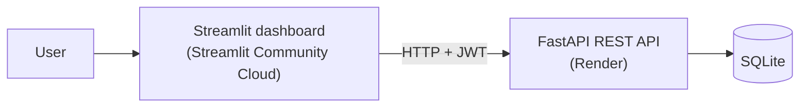

# Vault

A full-stack Python application for exploring income and spending. Built as a personal development project covering database design, an authenticated REST API, an interactive dashboard, and cloud deployment.

All records are generated sample data. No personal or company data is used.

## Live demo

- **Dashboard:** [Open Vault](https://jakemspringer-vault.streamlit.app/)
- **API docs:** [Swagger UI](https://vault-api-gz3v.onrender.com/docs)
- **Demo login:** `demo` / `demo123`

The API runs on a free tier and sleeps when idle, so the first request can take up to a minute.

## What it does

- Shows total income, spending, and net income for the actual reporting period.
- Compares monthly income and spending with interactive Plotly charts.
- Ranks spending categories with exact totals and proportional bars.
- Provides an expandable monthly data table, with amounts formatted to cents.
- Uses a responsive white report layout with green and sage data colors.
- Handles expired sessions, failed requests, empty results, and retrying the overview.

The dashboard displays summaries. Transaction creation, updates, and deletion are available through the API.

## Architecture



- **Database:** two tables, `user` and `transaction` (`transaction.user_id` → `user.id`), defined with SQLModel.
- **API:** FastAPI. Passwords are hashed with bcrypt. Login returns a JWT that expires after 60 minutes. Data endpoints require authentication and scope records to the logged-in user.
- **Dashboard:** Streamlit and Plotly. It never touches the database; all data comes through the API.
- **Sample data:** `scripts/seed.py` creates the demo user and ~12 months of transactions with Faker. The API runs it on startup if the demo user is missing.

| Path | Purpose |
|---|---|
| `api/main.py` | App setup and startup |
| `api/database.py` | Database connection |
| `api/models.py` | Tables and request/response schemas |
| `api/auth.py` | Password hashing, JWT, `/login` |
| `api/routers/transactions.py` | Transactions CRUD |
| `api/routers/summary.py` | Summary endpoints |
| `dashboard/app.py` | Streamlit dashboard |
| `dashboard/style.css` | Report layout and responsive styles |
| `.streamlit/config.toml` | Streamlit theme |
| `scripts/seed.py` | Sample data generator |
| `render.yaml` | Render API deployment configuration |
| `DESIGN.md` | Implemented design system |
| `PRODUCT.md` | Project purpose and constraints |

## API endpoints

The data endpoints below require an `Authorization: Bearer <token>` header. `/health` and `/login` are public; `/docs` provides the interactive API reference.

| Method | Path | Description |
|---|---|---|
| POST | `/login` | Get a JWT (form fields `username`, `password`) |
| POST | `/transactions` | Create a transaction |
| GET | `/transactions` | List transactions, newest first |
| GET | `/transactions/{id}` | Get one transaction |
| PATCH | `/transactions/{id}` | Update a transaction |
| DELETE | `/transactions/{id}` | Delete a transaction |
| GET | `/summary/by-category` | Spending totals per category |
| GET | `/summary/by-month` | Income and expense totals per month |
| GET | `/health` | Health check |

Amounts are positive for income and negative for expenses.

## Local setup

Requires Python 3.11 or newer. Local verification used Python 3.12.

### Windows PowerShell

```powershell
git clone https://github.com/jakemspringer/vault.git
cd vault
py -m venv .venv
.\.venv\Scripts\python.exe -m pip install -r requirements.txt
Copy-Item .env.example .env
```

Set `JWT_SECRET` in `.env` to a random value. Generate one with:

```powershell
.\.venv\Scripts\python.exe -c "import secrets; print(secrets.token_hex(32))"
```

Start the API from the repository root. Startup creates the database and seeds the demo account if it is missing:

```powershell
.\.venv\Scripts\python.exe -m uvicorn api.main:app --reload
```

In a second terminal, also at the repository root:

```powershell
.\.venv\Scripts\python.exe -m streamlit run dashboard/app.py
```

- Dashboard: [localhost:8501](http://localhost:8501)
- API docs: [localhost:8000/docs](http://localhost:8000/docs)

### macOS / Linux

Use `python3 -m venv .venv`, install with `.venv/bin/python -m pip install -r requirements.txt`, and copy `.env.example` to `.env`. Run the same modules with `.venv/bin/python` instead of `.\.venv\Scripts\python.exe`.

## Usage

**Dashboard:** log in with `demo` / `demo123`. Hover over the monthly chart for exact values, or expand **View monthly figures** to inspect the table. The category list shows spending from largest to smallest. Sign out to end the session.

**API:** open `/docs`, click **Authorize**, and enter the demo credentials. You can also call it from PowerShell:

```powershell
$vaultBase = 'http://localhost:8000'
$vaultLogin = Invoke-RestMethod "$vaultBase/login" -Method Post `
    -Body @{ username = 'demo'; password = 'demo123' }
$vaultHeaders = @{ Authorization = "Bearer $($vaultLogin.access_token)" }

Invoke-RestMethod "$vaultBase/summary/by-category" -Headers $vaultHeaders

Invoke-RestMethod "$vaultBase/transactions" -Method Post -Headers $vaultHeaders `
    -ContentType 'application/json' `
    -Body '{"date":"2026-11-12","amount":-24.99,"category":"Dining","description":"Sample lunch"}'
```

## Environment variables

| Variable | Used by | Default |
|---|---|---|
| `DATABASE_URL` | API | `sqlite:///./vault.db` |
| `JWT_SECRET` | API | Local-only fallback; set a real value when deployed |
| `API_URL` | Dashboard | `http://localhost:8000` |

The API loads `.env`. The dashboard reads `API_URL` from Streamlit secrets first, then the process environment. For a local API on another address, set `$env:API_URL` before starting Streamlit.

## Deployment

### API: Render

- Repository: `jakemspringer/vault`, branch `main`.
- Build command: `pip install -r requirements.txt`.
- Start command: `uvicorn api.main:app --host 0.0.0.0 --port $PORT`.
- Health check: `/health`.
- Set a generated `JWT_SECRET`. `render.yaml` also provides a Blueprint configuration with automatic secret generation.

The deployed demo uses SQLite on ephemeral storage. Changes made through the API can be lost when the service restarts or redeploys; sample records are seeded again if the demo user is missing. This is a shared demonstration account, not persistent financial storage.

### Dashboard: Streamlit Community Cloud

- Repository: `jakemspringer/vault`, branch `main`.
- Entry point: `dashboard/app.py`.
- Set the following Streamlit secret:

```toml
API_URL = "https://vault-api-gz3v.onrender.com"
```

Streamlit redeploys when changes are pushed to the connected branch.
